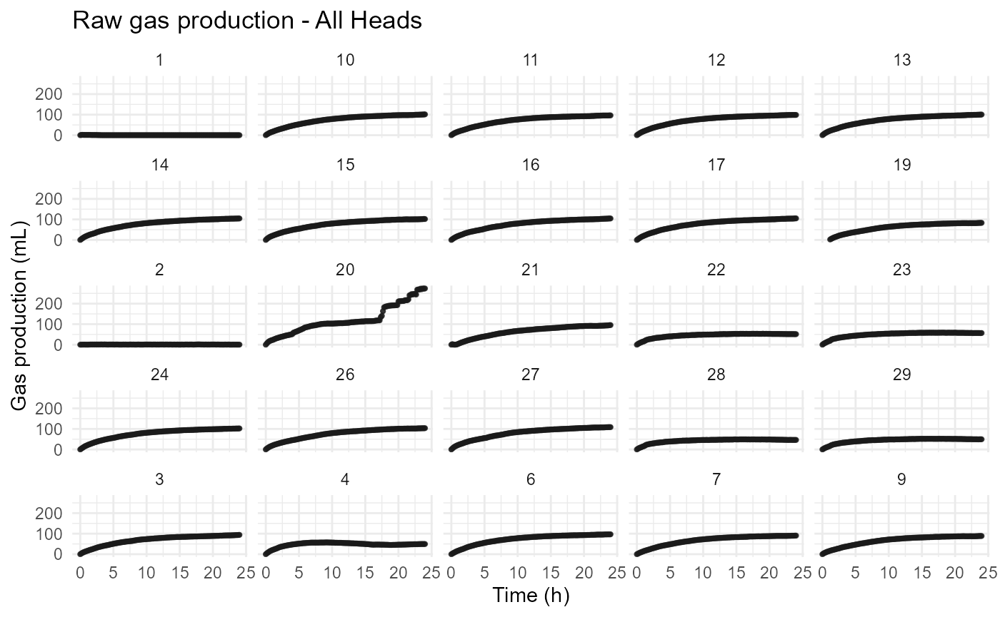
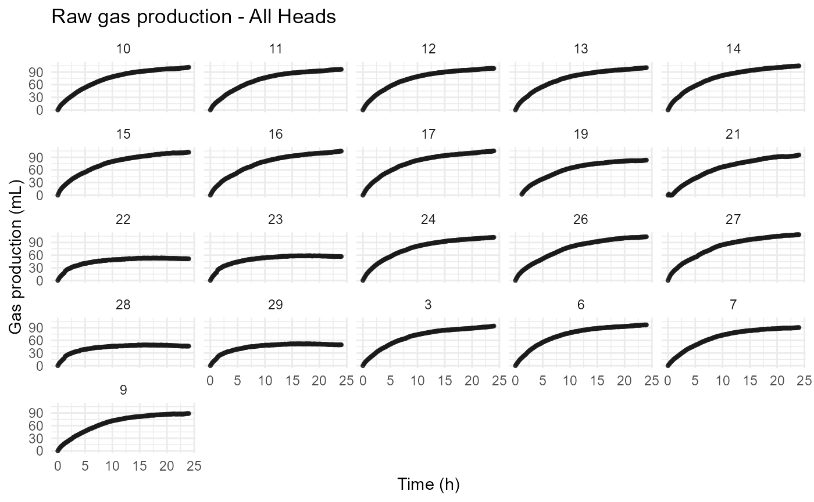
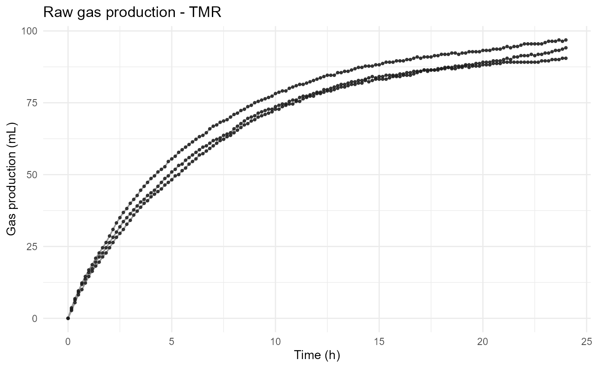
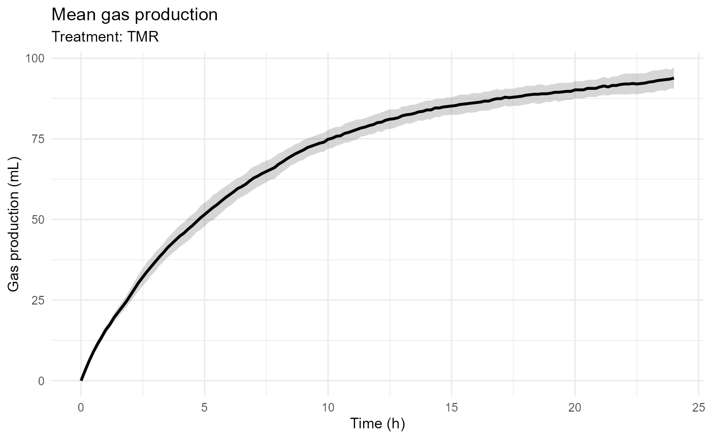

# Getting Started with rumenGP

## Introduction

**rumenGP** provides a complete workflow for analyzing *in vitro* rumen
gas production experiments.

The package supports:

- ANKOM RF datasets
- Manual gas-volume datasets
- Pressure-based datasets
- Fifteen built-in kinetic models
- User-defined kinetic models
- Model comparison and ranking
- Treatment-level model evaluation
- Diagnostic and visualization tools

This vignette demonstrates a complete workflow using the packaged ANKOM
example dataset.

``` r

library(rumenGP)
```

## Load Example Data

The package includes a small example dataset.

``` r

files <- example_data()

files
```

## Import ANKOM Data

Import the ANKOM RF output file and metadata table.

``` r

raw_data <- read_ankom(
  files$ankom
)

metadata <- read_metadata(
  files$metadata
)
```

## Validate Metadata

Before processing data, validate the metadata table.

``` r

metadata <- validate_metadata(
  metadata
)
#> Metadata validation passed.
#> Heads: 25
#> Treatment: 5
```

## Process ANKOM Data

Convert pressure measurements into cumulative gas production.

``` r

gp <- process_ankom(
  raw_data,
  metadata,
  headspace_ml = 210,
  temperature_c = 39,
  zero_negative_pressure = TRUE
)
```

Optional blank correction:

``` r

gp_blank_corrected <- process_ankom(
  raw_data,
  metadata,
  headspace_ml = 210,
  temperature_c = 39,
  zero_negative_pressure = TRUE,
  blank_correction = "subtract_mean"
)
```

When blank correction is enabled, the mean gas production of bottles
identified as `Treatment = "Blank"` is subtracted from all nonblank
bottles at each observation time.

## Validate Processed Data

The resulting datasets are standardized `rumen_gp` objects.

``` r

gp <- validate_ankom(
  gp
)
#> rumenGP data validation passed.
#> Observations: 3618
#> Heads: 25
#> Treatments: 5

gp_blank_corrected <- validate_ankom(
  gp_blank_corrected
)
#> rumenGP data validation passed.
#> Observations: 3618
#> Heads: 25
#> Treatments: 5

class(gp)
#> [1] "rumen_gp"   "tbl_df"     "tbl"        "data.frame"
```

Inspect the data:

``` r

head(gp)
#> # A tibble: 6 × 10
#>   time_raw Time_h Head  Gas_PSI Gas_kPa Gas_moles Gas_mL Bottle   Rep Treatment
#>   <chr>     <dbl> <chr>   <dbl>   <dbl>     <dbl>  <dbl>  <dbl> <dbl> <chr>    
#> 1 10:54:01      0 1           0       0         0      0      1     1 TMR      
#> 2 10:54:01      0 2           0       0         0      0      2     1 Blank    
#> 3 10:54:01      0 3           0       0         0      0      3     2 TMR      
#> 4 10:54:01      0 4           0       0         0      0      4     3 TMR      
#> 5 10:54:01      0 6           0       0         0      0      6     4 TMR      
#> 6 10:54:01      0 7           0       0         0      0      7     5 TMR
```

## Visualize Raw Gas Production

Individual bottle profiles can be visualized.

``` r

plot_gp(
  gp
)
```



Remove Abnormal heads

``` r

gp_clean <- exclude_heads(
  gp,
  heads = c("1", "2", "4", "20"),
  reason = "Sensor malfunction"
)

plot_gp(
  gp_clean
)
```



Treatment-level observations can also be visualized.

``` r

plot_gp(
  gp_clean,
  treatment = "TMR"
)
```



Mean treatment profiles can be displayed using:

``` r

plot_gp(
  gp_clean,
  treatment = "TMR",
  mean_treatment = TRUE
)
```



### Note on Blank Correction

Blank correction is optional because laboratories often follow different
preprocessing procedures.

By default, rumenGP retains the original gas-production values. When
`blank_correction = "subtract_mean"` is used, the mean gas production of
blank bottles is subtracted from all nonblank bottles prior to model
fitting and comparison.

## Fit Kinetic Models

Several built-in models are available.

``` r

groot_fit <- fit_groot(gp_clean)
#> rumenGP data validation passed.
#> Observations: 3038
#> Heads: 21
#> Treatments: 5

mm_fit <- fit_mm(gp_clean)
#> rumenGP data validation passed.
#> Observations: 3038
#> Heads: 21
#> Treatments: 5

gompertz_fit <- fit_gompertz(gp_clean)
#> rumenGP data validation passed.
#> Observations: 3038
#> Heads: 21
#> Treatments: 5

brody_fit <- fit_brody(gp_clean)
#> rumenGP data validation passed.
#> Observations: 3038
#> Heads: 21
#> Treatments: 5

burr_fit <- fit_burr_xii(gp_clean)
#> rumenGP data validation passed.
#> Observations: 3038
#> Heads: 21
#> Treatments: 5

inverse_paralogistic_fit <-  fit_inverse_paralogistic(gp_clean)
#> rumenGP data validation passed.
#> Observations: 3038
#> Heads: 21
#> Treatments: 5
```

## Summarize Model Fits

Each model provides parameter estimates and diagnostic statistics.

``` r

summary(groot_fit)
#> 
#> Groot model summary
#> -------------------
#> Total bottles: 21
#> Successful fits: 21
#> Failed fits: 0
#> Low R-squared (< 0.90): 0
```

## Identify Potentially Problematic Bottles

``` r

flags <- flag_model(
  groot_fit
)

head(flags)
#>   Head Bottle Rep Treatment Converged Status       RSS        R2      RMSE
#> 1   10     10   2       Low      TRUE     OK 150.63376 0.9983872 1.0227745
#> 2   11     11   3       Low      TRUE     OK 181.51413 0.9978351 1.1227265
#> 3   12     12   4       Low      TRUE     OK  81.41463 0.9990175 0.7519171
#> 4   13     13   1    Medium      TRUE     OK  84.42650 0.9989933 0.7656991
#> 5   14     14   2    Medium      TRUE     OK  60.68699 0.9993438 0.6491821
#> 6   15     15   3    Medium      TRUE     OK 153.90377 0.9982583 1.0338163
#>        AIC      BIC Lambda_Boundary Flag_FitFailed Flag_LowR2
#> 1 423.1398 435.0190           FALSE          FALSE      FALSE
#> 2 449.9932 461.8725           FALSE          FALSE      FALSE
#> 3 334.5371 346.4164           FALSE          FALSE      FALSE
#> 4 339.7681 351.6473           FALSE          FALSE      FALSE
#> 5 292.2262 304.1055           FALSE          FALSE      FALSE
#> 6 426.2323 438.1116           FALSE          FALSE      FALSE
#>   Flag_LambdaBoundary Overall_Flag
#> 1               FALSE           OK
#> 2               FALSE           OK
#> 3               FALSE           OK
#> 4               FALSE           OK
#> 5               FALSE           OK
#> 6               FALSE           OK
```

## Plot Model Fits

Observed and predicted values can be visualized.

``` r

plot_fit(
  groot_fit,
  head = "6"
)
```

## Plot Residuals

Residual plots help identify systematic deviations.

``` r

plot_residuals(
  groot_fit,
  head = "6"
)
```

## Compare Models

Compare model performance using multiple metrics.

``` r

comparison <- compare_models(

  Groot = groot_fit,

  MichaelisMenten = mm_fit,

  BurrXII = burr_fit,

  InverseParalogistic = inverse_paralogistic_fit,

  Gompertz = gompertz_fit,

  Brody = brody_fit

)

comparison
#>                 Model Bottles Successful_Fits Failed_Fits   Mean_R2 Mean_RMSE
#> 1               Groot      21              21           0 0.9967371 0.9955345
#> 2     MichaelisMenten      21              21           0 0.9970271 0.9922540
#> 3             BurrXII      21              21           0 0.9977366 0.8477629
#> 4 InverseParalogistic      21              21           0 0.9965796 1.0215285
#> 5            Gompertz      21              21           0 0.9725272 3.4607979
#> 6               Brody      21              21           0 0.9969746 0.9479644
#>    Mean_RSS Mean_AIC Mean_BIC Lambda_Boundary
#> 1  150.1038 406.9209 418.7920               0
#> 2  150.1038 408.6095 420.5070               0
#> 3  114.4515 358.4086 373.2805               0
#> 4  158.2528 414.1464 426.0175               0
#> 5 1848.1946 767.6180 779.5156              21
#> 6  144.1933 386.1759 398.0734               0
```

The comparison table includes:

- Mean R-squared
- Mean RMSE
- Mean RSS
- Mean AIC
- Mean BIC
- Number of successful fits

## Rank Models

``` r

rank_models(
  comparison
)
#>                 Model Bottles Successful_Fits Failed_Fits   Mean_R2 Mean_RMSE
#> 1               Groot      21              21           0 0.9967371 0.9955345
#> 2     MichaelisMenten      21              21           0 0.9970271 0.9922540
#> 3             BurrXII      21              21           0 0.9977366 0.8477629
#> 4 InverseParalogistic      21              21           0 0.9965796 1.0215285
#> 5            Gompertz      21              21           0 0.9725272 3.4607979
#> 6               Brody      21              21           0 0.9969746 0.9479644
#>    Mean_RSS Mean_AIC Mean_BIC Lambda_Boundary Rank_R2 Rank_RMSE Rank_AIC
#> 1  150.1038 406.9209 418.7920               0       4         4        3
#> 2  150.1038 408.6095 420.5070               0       2         3        4
#> 3  114.4515 358.4086 373.2805               0       1         1        1
#> 4  158.2528 414.1464 426.0175               0       5         5        5
#> 5 1848.1946 767.6180 779.5156              21       6         6        6
#> 6  144.1933 386.1759 398.0734               0       3         2        2
#>   Rank_BIC
#> 1        3
#> 2        4
#> 3        1
#> 4        5
#> 5        6
#> 6        2
```

## Compare Models by Treatment

Treatment-level comparisons are also available.

``` r

treatment_comparison <-  compare_models_by_treatment(

    Groot = groot_fit,

    MichaelisMenten = mm_fit,

    BurrXII = burr_fit,

    InverseParalogistic = inverse_paralogistic_fit,

    Gompertz = gompertz_fit,

    Brody = brody_fit

  )

treatment_comparison
#> # A tibble: 30 × 6
#>    Treatment Model           Mean_R2 Mean_RMSE Mean_AIC Mean_BIC
#>    <chr>     <chr>             <dbl>     <dbl>    <dbl>    <dbl>
#>  1 Blank     Groot             0.990     1.04      426.     438.
#>  2 High      Groot             0.998     1.19      457.     469.
#>  3 Low       Groot             0.998     1.04      420.     432.
#>  4 Medium    Groot             0.999     0.864     369.     380.
#>  5 TMR       Groot             0.999     0.827     356.     368.
#>  6 Blank     MichaelisMenten   0.991     1.03      428.     440.
#>  7 High      MichaelisMenten   0.998     1.18      460.     471.
#>  8 Low       MichaelisMenten   0.998     1.04      422.     433.
#>  9 Medium    MichaelisMenten   0.999     0.861     370.     382.
#> 10 TMR       MichaelisMenten   0.999     0.824     357.     369.
#> # ℹ 20 more rows
```

## Rank Models by Treatment

``` r

ranked_treatments <-
  rank_models_by_treatment(
    treatment_comparison
  )

ranked_treatments
#> # A tibble: 30 × 10
#>    Treatment Model         Mean_R2 Mean_RMSE Mean_AIC Mean_BIC Rank_R2 Rank_RMSE
#>    <chr>     <chr>           <dbl>     <dbl>    <dbl>    <dbl>   <int>     <int>
#>  1 Blank     Groot           0.990     1.04      426.     438.       4         3
#>  2 High      Groot           0.998     1.19      457.     469.       4         4
#>  3 Low       Groot           0.998     1.04      420.     432.       4         4
#>  4 Medium    Groot           0.999     0.864     369.     380.       3         3
#>  5 TMR       Groot           0.999     0.827     356.     368.       4         4
#>  6 Blank     MichaelisMen…   0.991     1.03      428.     440.       2         2
#>  7 High      MichaelisMen…   0.998     1.18      460.     471.       3         3
#>  8 Low       MichaelisMen…   0.998     1.04      422.     433.       2         3
#>  9 Medium    MichaelisMen…   0.999     0.861     370.     382.       2         2
#> 10 TMR       MichaelisMen…   0.999     0.824     357.     369.       3         3
#> # ℹ 20 more rows
#> # ℹ 2 more variables: Rank_AIC <int>, Rank_BIC <int>
```

## Determine the Best Model per Treatment

``` r

best_models <-
  best_model_by_treatment(
    ranked_treatments
  )

best_models
#> # A tibble: 5 × 12
#>   Treatment Model Mean_R2 Mean_RMSE Mean_AIC Mean_BIC Rank_R2 Rank_RMSE Rank_AIC
#>   <chr>     <chr>   <dbl>     <dbl>    <dbl>    <dbl>   <int>     <int>    <int>
#> 1 Blank     Burr…   0.993     0.917     396.     411.       1         1        1
#> 2 High      Burr…   0.998     1.16      453.     468.       2         1        1
#> 3 Low       Burr…   0.999     0.749     331.     346.       1         1        1
#> 4 Medium    Burr…   0.999     0.850     367.     382.       1         1        1
#> 5 TMR       Burr…   1.000     0.500     214.     229.       1         1        1
#> # ℹ 3 more variables: Rank_BIC <int>, Total_Rank <int>, Overall_Rank <int>
```

## Model Win Frequency

``` r

model_win_frequency(
  best_models
)
#> # A tibble: 1 × 2
#>   Model   Treatments_Won
#>   <chr>            <int>
#> 1 BurrXII              5
```

## Quality Control Workflow

A typical workflow is:

``` text
Import data
    ↓
Validate metadata
    ↓
Process ANKOM data
    ↓
Validate processed data
    ↓
Fit multiple candidate models
    ↓
Flag problematic bottles
    ↓
Inspect residuals
    ↓
Exclude problematic bottles
    ↓
Refit models
    ↓
Compare RMSE
    ↓
Compare AIC and BIC
    ↓
Select final model
```

Example bottle exclusion:

``` r

gp_clean <- exclude_heads(
  gp,
  heads = c("10"),
  reason = "Sensor malfunction"
)
```

## Available Models

Current built-in models:

- Brody
- Burr XII
- Dual Logistic
- EXP0
- EXPL
- Generalized Michaelis-Menten
- Gompertz
- Groot
- Inverse Paralogistic
- LE0
- LEL
- Logistic
- Log-logistic
- Mitscherlich
- Ørskov and McDonald

## Model Equivalence

### Groot and Generalized Michaelis-Menten

The Groot and generalized Michaelis-Menten models are mathematically
equivalent for positive values of time.

Parameter correspondence:

- VF = A
- b = K
- k = c

Both formulations describe the same underlying sigmoidal gas production
curve but differ in parameterization.

The Groot model contains the term

``` math
\left(\frac{b}{t}\right)^k
```

and is therefore undefined at
``` math
t = 0.
```

Consequently, observations collected at `Time_h = 0` are excluded when
fitting the Groot model.

Researchers may choose either formulation depending on the terminology
commonly used in their field.

### Groot, Generalized Michaelis-Menten, and Log-logistic

The Log-logistic formulation

``` math
V(t)
=
VF
\frac{(rt)^a}
{
1 + (rt)^a
}
```

can be rewritten as

``` math
V(t)
=
VF
\frac{t^a}
{
t^a + (1/r)^a
}
```

which is mathematically equivalent to both the Groot and generalized
Michaelis-Menten models for positive values of time.

Parameter correspondence:

| Groot | Generalized Michaelis-Menten | Log-logistic |
|-------|------------------------------|--------------|
| VF    | A                            | VF           |
| b     | K                            | 1/r          |
| k     | c                            | a            |

Therefore:

``` text
Groot
=
Generalized Michaelis-Menten
=
Log-logistic
```

## Recommended Model Selection Workflow

No single gas-production model should be considered universally
superior.

A recommended workflow is:

1.  Fit several biologically plausible models.
2.  Verify convergence.
3.  Inspect fitted curves.
4.  Examine residuals.
5.  Compare RMSE.
6.  Compare AIC and BIC.
7.  Evaluate biological plausibility of parameter estimates.
8.  Select the model most appropriate for the scientific objective.

Recent comparative work has identified Burr XII, Inverse Paralogistic,
and Log-logistic formulations among the strong-performing models across
diverse feed datasets.

Because the Log-logistic formulation is mathematically equivalent to the
existing Groot and generalized Michaelis-Menten models, rumenGP already
provides this curve family through those parameterizations.

## New Additions

### Burr XII

Equation:

``` math
V(t)
=
VF
\left[
1
-
\left(
1+(rt)^a
\right)^{-p}
\right]
```

Parameters:

- VF: asymptotic gas production
- r: rate parameter
- a: shape parameter
- p: shape parameter

Potential advantages:

- Highly flexible curve shape
- Accommodates diverse fermentation profiles
- Often produces excellent goodness-of-fit
- Useful for comparative model evaluation

Potential limitations:

- Four-parameter model
- Greater risk of overfitting than simpler models
- Parameter interpretation may be less intuitive

### Inverse Paralogistic

Equation:

``` math
V(t)
=
VF
\left[
1
+
(rt)^{-a}
\right]^{-a}
```

Parameters:

- VF: asymptotic gas production
- r: rate parameter
- a: shape parameter

Potential advantages:

- Flexible sigmoidal behavior
- Relatively simple parameterization
- Performs well across diverse kinetic profiles

Potential limitations:

- Less common in rumen literature
- Shape parameter can be difficult to interpret
- Requires positive incubation times

Neither Burr XII nor Inverse Paralogistic should be considered
universally superior.

Model performance depends on feed type, experimental design, data
quality, and model-selection criteria.

## Next Steps

Additional package capabilities include:

### Importing Manual Datasets

``` r

gp <- as_rumen_gp(
  data = my_data,
  head_col = "Bottle",
  time_col = "Time",
  gas_col = "Gas"
)
```

### Importing Pressure Data

``` r

gp <- as_rumen_gp(
  data = my_data,
  head_col = "Bottle",
  time_col = "Time",
  pressure_col = "PSI",
  pressure_unit = "psi",
  headspace_volume = 60
)
```

### User-Defined Models

``` r

custom_fit <- fit_custom(
  data = gp,
  formula =
    Gas_mL ~
      A *
      (
        Time_h /
        (
          Time_h + K
        )
      ),
  start = list(
    A = 150,
    K = 10
  ),
  lower = c(
    A = 0,
    K = 0
  ),
  model_name = "Hyperbolic"
)
```

See:

``` r

?as_rumen_gp
?fit_custom
```

for additional details.

## Summary

rumenGP provides a complete workflow for importing, processing,
visualizing, fitting, comparing, and interpreting in vitro rumen
gas-production data.

Current capabilities include:

- ANKOM RF workflows
- Manual gas-volume workflows
- Pressure-based workflows
- Fifteen built-in kinetic models
- User-defined models
- Model comparison and ranking
- Treatment-level model evaluation
- Diagnostic tools
- Visualization tools

Researchers are encouraged to compare multiple biologically plausible
models and to consider both statistical performance and biological
interpretation before selecting a final model.
