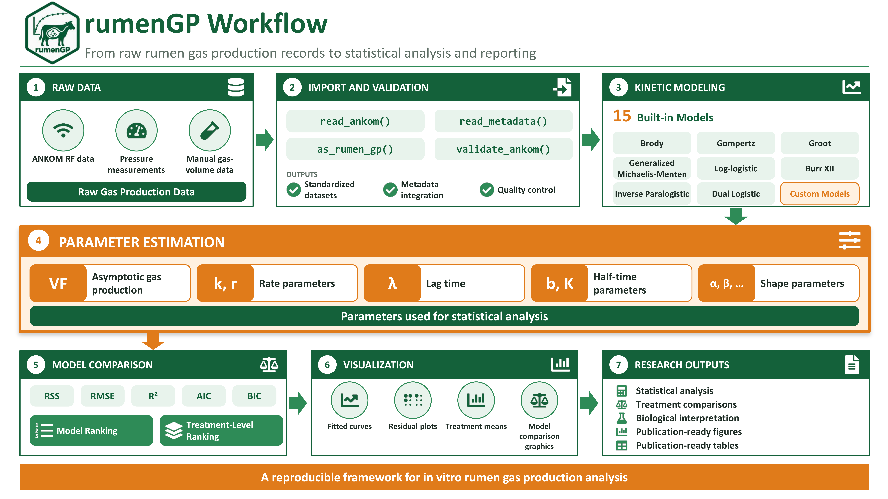

# rumenGP


**rumenGP** is an R package for importing, processing, visualizing,
fitting, comparing, and interpreting *in vitro* rumen gas production
data.

The package supports:

- ANKOM RF datasets
- Manually collected gas-volume datasets
- Pressure-based datasets (PSI or kPa)
- Fifteen built-in kinetic models
- User-defined kinetic models
- Model comparison and ranking
- Treatment-level model evaluation
- Diagnostic and visualization tools

------------------------------------------------------------------------

## Installation

Development version:

``` r

# install.packages("devtools")

devtools::install_github(
  "araujorodrig-lab/rumenGP"
)
```

Or install from a local source:

``` r

devtools::install_local(
  "path/to/rumenGP"
)
```

------------------------------------------------------------------------

## Package Workflow



------------------------------------------------------------------------

## Example Workflow: ANKOM Data

``` r

library(rumenGP)
```

### Load and Import Example Data

The package includes a small example dataset that can be used to learn
the workflow and test package functionality.

``` r

files <- example_data()

raw_data <- read_ankom(
  files$ankom
)

metadata <- read_metadata(
  files$metadata
)
```

### Inspect ANKOM Data

The ANKOM RF file contains pressure measurements collected during the
incubation period.

``` r

head(raw_data)
#> # A tibble: 6 × 52
#>   time_raw   `0`   `1`    `2`   `3`   `4` `5`     `6`   `7`   `8`   `9`  `10`
#>   <chr>    <dbl> <dbl>  <dbl> <dbl> <dbl> <lgl> <dbl> <dbl> <dbl> <dbl> <dbl>
#> 1 10:54:01  14.1 0     0      0     0     NA    0     0         0 0     0    
#> 2 11:04:01  14.1 0.109 0      0.291 0.364 NA    0.255 0.218     0 0.291 0.291
#> 3 11:14:01  14.1 0.146 0.0364 0.546 0.655 NA    0.509 0.437     0 0.509 0.546
#> 4 11:24:01  14.1 0.109 0.0364 0.764 0.983 NA    0.728 0.655     0 0.728 0.837
#> 5 11:34:01  14.1 0.109 0.0364 0.946 1.24  NA    0.983 0.801     0 0.910 1.02 
#> 6 11:44:01  14.1 0.109 0.0364 1.09  1.46  NA    1.16  0.983     0 1.06  1.20 
#> # ℹ 40 more variables: `11` <dbl>, `12` <dbl>, `13` <dbl>, `14` <dbl>,
#> #   `15` <dbl>, `16` <dbl>, `17` <dbl>, `18` <dbl>, `19` <dbl>, `20` <dbl>,
#> #   `21` <dbl>, `22` <dbl>, `23` <dbl>, `24` <dbl>, `25` <lgl>, `26` <dbl>,
#> #   `27` <dbl>, `28` <dbl>, `29` <dbl>, `30` <lgl>, `31` <lgl>, `32` <lgl>,
#> #   `33` <lgl>, `34` <lgl>, `35` <lgl>, `36` <lgl>, `37` <lgl>, `38` <lgl>,
#> #   `39` <lgl>, `40` <lgl>, `41` <lgl>, `42` <lgl>, `43` <lgl>, `44` <lgl>,
#> #   `45` <lgl>, `46` <lgl>, `47` <lgl>, `48` <lgl>, `49` <lgl>, `50` <lgl>
```

### Inspect Metadata

The metadata table contains bottle identifiers, treatments, and
replicate information.

``` r

head(metadata)
#> # A tibble: 6 × 4
#>   Bottle  Head   Rep Treatment
#>    <dbl> <dbl> <dbl> <chr>    
#> 1      1     1     1 TMR      
#> 2      2     2     1 Blank    
#> 3      3     3     2 TMR      
#> 4      4     4     3 TMR      
#> 5      6     6     4 TMR      
#> 6      7     7     5 TMR
```

### Validate metadata

``` r

metadata <- validate_metadata(
  metadata
)
#> Metadata validation passed.
#> Heads: 25
#> Treatment: 5
```

### Process ANKOM Data

Standard processing:

``` r

gp <- process_ankom(
  raw_data,
  metadata,
  headspace_ml = 210,
  temperature_c = 39,
  zero_negative_pressure = TRUE
)
```

Optional blank correction:

``` r

gp_blank_corrected <- process_ankom(
  raw_data,
  metadata,
  headspace_ml = 210,
  temperature_c = 39,
  zero_negative_pressure = TRUE,
  blank_correction = "subtract_mean"
)
```

When blank correction is enabled, the mean gas production of bottles
labeled `"Blank"` is subtracted from all nonblank bottles at each
observation time.

### Validate processed data

``` r

gp <- validate_ankom(
  gp
)
#> rumenGP data validation passed.
#> Observations: 3618
#> Heads: 25
#> Treatments: 5
```

``` r

gp_blank_corrected <- validate_ankom(
  gp_blank_corrected
)
#> rumenGP data validation passed.
#> Observations: 3618
#> Heads: 25
#> Treatments: 5
```

### Blank Correction

Blank correction is optional because laboratories may follow different
preprocessing protocols. By default, rumenGP retains the original
gas-production values.

When `blank_correction = "subtract_mean"` is used, the mean gas
production of blank bottles is subtracted from all nonblank bottles
before model fitting. Negative gas values generated by the correction
are truncated to zero by default.

------------------------------------------------------------------------

## Example Workflow: Manual Gas Volume Data

``` r

manual_volume <- data.frame(

  Bottle = c(
    1,1,1,
    2,2,2
  ),

  Treatment = c(
    "Control","Control","Control",
    "Corn","Corn","Corn"
  ),

  Time = c(
    0,4,8,
    0,4,8
  ),

  Gas = c(
    0,20,40,
    0,35,60
  )

)

gp_manual <- as_rumen_gp(
  data = manual_volume,
  head_col = "Bottle",
  treatment_col = "Treatment",
  time_col = "Time",
  gas_col = "Gas"
)

head(gp_manual)
#>   Head Bottle Rep Treatment Time_h Gas_mL
#> 1    1      1   1   Control      0      0
#> 2    1      1   1   Control      4     20
#> 3    1      1   1   Control      8     40
#> 4    2      2   1      Corn      0      0
#> 5    2      2   1      Corn      4     35
#> 6    2      2   1      Corn      8     60
```

------------------------------------------------------------------------

## Example Workflow: Pressure Data

``` r

manual_pressure <- data.frame(

  Bottle = rep(
    1,
    10
  ),

  Time = c(
    0,2,4,6,8,
    12,16,24,36,48
  ),

  PSI = c(
    0,
    0.2,
    0.5,
    0.8,
    1.2,
    1.8,
    2.5,
    3.2,
    4.0,
    4.5
  )

)

gp_pressure <- as_rumen_gp(
  data = manual_pressure,
  head_col = "Bottle",
  time_col = "Time",
  pressure_col = "PSI",
  pressure_unit = "psi",
  headspace_volume = 60
)

head(gp_pressure)
#>   Head Bottle Rep Treatment Time_h    Gas_mL
#> 1    1      1   1   Unknown      0 0.0000000
#> 2    1      1   1   Unknown      2 0.7140855
#> 3    1      1   1   Unknown      4 1.7852138
#> 4    1      1   1   Unknown      6 2.8563421
#> 5    1      1   1   Unknown      8 4.2845132
#> 6    1      1   1   Unknown     12 6.4267698
```

Pressure measurements are automatically converted to gas volume using
the same conversion framework used by
[`process_ankom()`](https://araujorodrig-lab.github.io/rumenGP/reference/process_ankom.md).

------------------------------------------------------------------------

## Model Fitting

``` r

groot_fit <- fit_groot(gp)
#> rumenGP data validation passed.
#> Observations: 3618
#> Heads: 25
#> Treatments: 5

brody_fit <- fit_brody(gp)
#> rumenGP data validation passed.
#> Observations: 3618
#> Heads: 25
#> Treatments: 5

gompertz_fit <- fit_gompertz(gp)
#> rumenGP data validation passed.
#> Observations: 3618
#> Heads: 25
#> Treatments: 5
```

### Model summaries

``` r

summary(groot_fit)
#> 
#> Groot model summary
#> -------------------
#> Total bottles: 25
#> Successful fits: 25
#> Failed fits: 0
#> Low R-squared (< 0.90): 4
```

------------------------------------------------------------------------

## Compare Models

``` r

comparison <- compare_models(

  Groot = fit_groot(gp),

  Brody = fit_brody(gp),

  Gompertz = fit_gompertz(gp)

)
#> rumenGP data validation passed.
#> Observations: 3618
#> Heads: 25
#> Treatments: 5
#> rumenGP data validation passed.
#> Observations: 3618
#> Heads: 25
#> Treatments: 5
#> rumenGP data validation passed.
#> Observations: 3618
#> Heads: 25
#> Treatments: 5

comparison
#>      Model Bottles Successful_Fits Failed_Fits   Mean_R2 Mean_RMSE Mean_RSS
#> 1    Groot      25              25           0 0.9053385  1.945126 3229.918
#> 2    Brody      25              23           2 0.9863461  2.027406 3500.071
#> 3 Gompertz      25              24           1 0.9292863  3.916214 3433.728
#>   Mean_AIC Mean_BIC Lambda_Boundary
#> 1 436.0919 447.9643               0
#> 2 445.7973 457.6956               0
#> 3 760.7782 772.6769              22
```

### Rank Models

``` r

rank_models(
  comparison
)
#>      Model Bottles Successful_Fits Failed_Fits   Mean_R2 Mean_RMSE Mean_RSS
#> 1    Groot      25              25           0 0.9053385  1.945126 3229.918
#> 2    Brody      25              23           2 0.9863461  2.027406 3500.071
#> 3 Gompertz      25              24           1 0.9292863  3.916214 3433.728
#>   Mean_AIC Mean_BIC Lambda_Boundary Rank_R2 Rank_RMSE Rank_AIC Rank_BIC
#> 1 436.0919 447.9643               0       3         1        1        1
#> 2 445.7973 457.6956               0       1         2        2        2
#> 3 760.7782 772.6769              22       2         3        3        3
```

------------------------------------------------------------------------

## Treatment-Level Comparison

``` r

treatment_comparison <-
  compare_models_by_treatment(

    Groot = fit_groot(gp),

    Brody = fit_brody(gp),

    Gompertz = fit_gompertz(gp)

  )
#> rumenGP data validation passed.
#> Observations: 3618
#> Heads: 25
#> Treatments: 5
#> rumenGP data validation passed.
#> Observations: 3618
#> Heads: 25
#> Treatments: 5
#> rumenGP data validation passed.
#> Observations: 3618
#> Heads: 25
#> Treatments: 5

ranked_treatments <-
  rank_models_by_treatment(
    treatment_comparison
  )

best_model_by_treatment(
  ranked_treatments
)
#> # A tibble: 6 × 12
#>   Treatment Model Mean_R2 Mean_RMSE Mean_AIC Mean_BIC Rank_R2 Rank_RMSE Rank_AIC
#>   <chr>     <chr>   <dbl>     <dbl>    <dbl>    <dbl>   <int>     <int>    <int>
#> 1 Blank     Groot   0.792     0.890     355.     366.       2         1        1
#> 2 High      Groot   0.976     5.51      629.     641.       2         2        1
#> 3 High      Brody   0.977     5.49      631.     643.       1         1        2
#> 4 Low       Brody   0.998     0.870     340.     352.       1         1        1
#> 5 Medium    Groot   0.999     0.864     369.     380.       1         1        1
#> 6 TMR       Brody   0.964     1.42      397.     409.       1         2        1
#> # ℹ 3 more variables: Rank_BIC <int>, Total_Rank <int>, Overall_Rank <int>
```

------------------------------------------------------------------------

## User-Defined Models

Researchers can fit their own kinetic equations using
[`fit_custom()`](https://araujorodrig-lab.github.io/rumenGP/reference/fit_custom.md).

``` r

custom_fit <- fit_custom(

  data = gp,

  formula =
    Gas_mL ~
      A *
      (
        Time_h /
        (
          Time_h + K
        )
      ),

  start = list(
    A = 150,
    K = 10
  ),

  lower = c(
    A = 0,
    K = 0
  ),

  model_name = "Hyperbolic"

)
#> rumenGP data validation passed.
#> Observations: 3618
#> Heads: 25
#> Treatments: 5

summary(custom_fit)
#> 
#> Custom model summary
#> --------------------
#> Model name: Hyperbolic
#> 
#> Formula:
#> Gas_mL ~ A * (Time_h/(Time_h + K))
#> 
#> Total bottles: 25
#> Successful fits: 24
#> Failed fits: 1
#> Mean R-squared: 0.9046
#> Mean RMSE: 1.3572
#> Mean AIC: 455.0445
#> Mean BIC: 463.9685
```

Compare custom and built-in models:

``` r

compare_models(

  Groot = fit_groot(gp),

  Brody = fit_brody(gp),

  Hyperbolic = custom_fit

)
#> rumenGP data validation passed.
#> Observations: 3618
#> Heads: 25
#> Treatments: 5
#> rumenGP data validation passed.
#> Observations: 3618
#> Heads: 25
#> Treatments: 5
#>        Model Bottles Successful_Fits Failed_Fits   Mean_R2 Mean_RMSE  Mean_RSS
#> 1      Groot      25              25           0 0.9053385  1.945126 3229.9183
#> 2      Brody      25              23           2 0.9863461  2.027406 3500.0705
#> 3 Hyperbolic      25              24           1 0.9046316  1.357169  400.0963
#>   Mean_AIC Mean_BIC Lambda_Boundary
#> 1 436.0919 447.9643               0
#> 2 445.7973 457.6956               0
#> 3 455.0445 463.9685               0
```

------------------------------------------------------------------------

## Visualization

### Raw gas production

``` r

plot_gp(
  gp,
  head = "6"
)
```

### Plot model fit

``` r

plot_fit(
  groot_fit,
  head = "6"
)
```

### Plot residuals

``` r

plot_residuals(
  groot_fit,
  head = "6"
)
```

### Treatment means

``` r

plot_treatment_mean(
  Groot = fit_groot(gp),
  Brody = fit_brody(gp),
  treatment = "Control"
)
```

------------------------------------------------------------------------

## Quality Control Workflow

``` text
Import data
    ↓
Validate metadata
    ↓
Create rumen_gp object
    ↓
Fit models
    ↓
Flag problematic bottles
    ↓
Inspect residuals
    ↓
Document exclusions
    ↓
Refit models
    ↓
Compare models
```

Example:

``` r

gp_clean <- exclude_heads(
  gp,
  heads = c("10"),
  reason = "Sensor malfunction"
)
```

------------------------------------------------------------------------

## Implemented Models

### Built-in Models

- Brody
- Burr XII
- Dual Logistic
- EXP0
- EXPL
- Generalized Michaelis-Menten
- Gompertz
- Groot
- Inverse Paralogistic
- LE0
- LEL
- Logistic
- Log-logistic
- Mitscherlich
- Ørskov and McDonald

### Model Equivalence

Several model formulations included in rumenGP are mathematically
equivalent and are provided because different scientific disciplines and
publications prefer different parameterizations.

#### Groot ↔︎ Generalized Michaelis-Menten

The Groot model

V(t) = VF / \[1 + (b/t)^k\]

is mathematically equivalent to the generalized Michaelis-Menten model

V(t) = A t^c / (t^c + K^c)

for positive values of time.

Parameter correspondence:

- VF = A
- b = K
- k = c

Both formulations describe the same underlying sigmoidal gas production
curve but differ in parameterization.

**Note:** The Groot formulation contains the term `(b/t)^k` and is
therefore undefined at `t = 0`. Consequently, observations collected at
`Time_h = 0` are excluded when fitting the Groot model.

Researchers may choose either formulation according to the terminology
commonly used in their field.

#### Groot ↔︎ Generalized Michaelis-Menten ↔︎ Log-logistic

The Log-logistic model

V(t) = VF(rt)^a / \[1 + (rt)^a\]

can be rewritten as

V(t) = VF t^a / \[t^a + (1/r)^a\]

which is mathematically equivalent to both the Groot and generalized
Michaelis-Menten formulations for positive values of time.

Parameter correspondence:

| Groot | Generalized Michaelis-Menten | Log-logistic |
|-------|------------------------------|--------------|
| VF    | A                            | VF           |
| b     | K                            | 1/r          |
| k     | c                            | a            |

These formulations describe the same underlying gas production curve and
differ only in parameterization.

Unlike the Groot model, the generalized Michaelis-Menten and
Log-logistic formulations are mathematically defined at `t = 0` and
therefore retain the initial observation during model fitting.
Consequently, parameter estimates and goodness-of-fit statistics may
differ slightly among parameterizations when time-zero observations are
present.

rumenGP implements all three parameterizations, allowing researchers to
choose the formulation that is most familiar within their field while
recognizing their underlying mathematical equivalence.

### Recent Model Additions

#### Burr XII

Equation:

V(t) = VF \[1 - (1 + (rt)^(a))(-p)\]

Parameters:

- VF: asymptotic gas production
- r: rate parameter
- a: shape parameter
- p: shape parameter

Advantages:

- Highly flexible sigmoidal behavior
- Accommodates diverse fermentation profiles
- Often provides strong goodness-of-fit
- Useful for comparative model evaluation

Limitations:

- Four-parameter model
- Greater risk of overfitting than simpler models
- Parameter interpretation may be less intuitive

#### Inverse Paralogistic

Equation:

V(t) = VF \[1 + (rt)^((-a)\])(-a)

Parameters:

- VF: asymptotic gas production
- r: rate parameter
- a: shape parameter

Advantages:

- Flexible sigmoidal behavior
- Biologically meaningful asymptote
- Performs well across diverse curve shapes

Limitations:

- Shape parameter may be difficult to interpret
- Requires positive incubation times
- Less commonly used than traditional rumen models

Neither Burr XII nor Inverse Paralogistic should be regarded as
universally superior.

Model performance depends on feed type, experimental design, data
quality, and the model-selection criteria used.

------------------------------------------------------------------------

## Recommended Model Selection Workflow

No single gas production model is expected to perform best for every
dataset.

A recommended workflow is:

1.  Fit several biologically plausible models.
2.  Verify model convergence.
3.  Inspect fitted curves visually.
4.  Examine residual patterns.
5.  Compare RMSE, AIC, and BIC.
6.  Evaluate parameter plausibility.
7.  Select the model most appropriate for the research objective.

Published comparative work has reported strong performance for Burr XII,
Inverse Paralogistic, and Log-logistic formulations across diverse feed
datasets.

Because the Log-logistic formulation is mathematically equivalent to
both Groot and generalized Michaelis-Menten models, rumenGP already
provides this curve family through those existing parameterizations.

------------------------------------------------------------------------

## Major Features

### Data Import

- [`process_ankom()`](https://araujorodrig-lab.github.io/rumenGP/reference/process_ankom.md)
- [`as_rumen_gp()`](https://araujorodrig-lab.github.io/rumenGP/reference/as_rumen_gp.md)

### Modeling

- 15 built-in kinetic models
- Burr XII
- Inverse Paralogistic
- [`fit_custom()`](https://araujorodrig-lab.github.io/rumenGP/reference/fit_custom.md)

### Diagnostics

- [`summary()`](https://rdrr.io/r/base/summary.html)
- [`flag_model()`](https://araujorodrig-lab.github.io/rumenGP/reference/flag_model.md)
- [`exclude_heads()`](https://araujorodrig-lab.github.io/rumenGP/reference/exclude_heads.md)

### Visualization

- [`plot_gp()`](https://araujorodrig-lab.github.io/rumenGP/reference/plot_gp.md)
- [`plot_fit()`](https://araujorodrig-lab.github.io/rumenGP/reference/plot_fit.md)
- [`plot_residuals()`](https://araujorodrig-lab.github.io/rumenGP/reference/plot_residuals.md)
- [`plot_treatment_mean()`](https://araujorodrig-lab.github.io/rumenGP/reference/plot_treatment_mean.md)

### Model Comparison

- [`compare_models()`](https://araujorodrig-lab.github.io/rumenGP/reference/compare_models.md)
- [`rank_models()`](https://araujorodrig-lab.github.io/rumenGP/reference/rank_models.md)
- [`compare_models_by_treatment()`](https://araujorodrig-lab.github.io/rumenGP/reference/compare_models_by_treatment.md)
- [`rank_models_by_treatment()`](https://araujorodrig-lab.github.io/rumenGP/reference/rank_models_by_treatment.md)
- [`best_model_by_treatment()`](https://araujorodrig-lab.github.io/rumenGP/reference/best_model_by_treatment.md)
- [`model_win_frequency()`](https://araujorodrig-lab.github.io/rumenGP/reference/model_win_frequency.md)

------------------------------------------------------------------------

### Completed

- ✅ ANKOM RF workflow
- ✅ Generic data import
- ✅ Pressure-based workflows
- ✅ Fifteen kinetic models
- ✅ Burr XII model
- ✅ Inverse Paralogistic model
- ✅ Custom model framework
- ✅ Model comparison framework
- ✅ Treatment-level model ranking
- ✅ Model-equivalence documentation
- ✅ Diagnostic workflows
- ✅ Visualization tools
- ✅ Five package vignettes
- ✅ pkgdown website
- ✅ Clean R CMD check

### Development Status

rumenGP is currently maintained and developed as an open-source
framework for rumen gas production analysis.

Current releases support:

- ANKOM RF workflows
- Manual gas production workflows
- Pressure-based workflows
- Fifteen nonlinear gas production models
- User-defined kinetic models
- Model comparison and ranking
- Treatment-level evaluation
- Visualization and diagnostics

Future releases may include additional reporting, model-evaluation, and
statistical workflows.

------------------------------------------------------------------------
